

<h1 align="center">Modern Recipe Book</h1>

A recipe book, bestiary and storage browser for every item and mob in Terraria and its mods, for tModLoader.

<b>English</b> · <a href="README.ru.md">Русский</a>

Press **Mouse3** (middle click) and the book opens over the game. Every item and mob of the game and of every loaded
mod is in it, read from the game itself, not from a wiki: recipes, drops, bags, shops, crates, fishing, world
generation and spawn rules. It answers *what is it*, *how do I get it*, *when in the game can I get it* and *can I make
it right now from what I have*.

## Contents

- [About the project](#about-the-project)
- [Why use it](#why-use-it)
- [Features](#features)
  - [Six tabs](#six-tabs)
  - [Search, categories and favorites](#search-categories-and-favorites)
  - [Quick search (Ctrl+F)](#quick-search-ctrlf)
  - [Links everywhere](#links-everywhere)
  - [Sorting](#sorting)
  - [Progression: stages and "Before: boss"](#progression-stages-and-before-boss)
  - [Class buttons and weapon traits](#class-buttons-and-weapon-traits)
  - [Crafting stations and "Craftable"](#crafting-stations-and-craftable)
  - [The item card](#the-item-card)
  - [How to Get](#how-to-get)
  - [Nearby storage](#nearby-storage)
  - [Magic Storage integration](#magic-storage-integration)
  - [Calamity integration](#calamity-integration)
  - [Bestiary](#bestiary)
  - [Tracking](#tracking)
  - [Map teleport and shared markers](#map-teleport-and-shared-markers)
  - [Keyboard and navigation](#keyboard-and-navigation)
  - [Languages](#languages)
- [Compatibility](#compatibility)
- [Installation](#installation)
- [Controls](#controls)
- [Configuration](#configuration)
- [Multiplayer](#multiplayer)
- [Building from source](#building-from-source)
- [Repository layout](#repository-layout)
- [Contributing](#contributing)
- [Changelog](#changelog)
- [License](#license)
- [Credits](#credits)

## About the project

I made Modern Recipe Book for myself: I could not find a recipe or storage mod that was both convenient and pleasant
to look at. It is a personal project, so regular updates are not promised, and it depends on the versions of
tModLoader, Calamity and Magic Storage it was built and tested against (see [Compatibility](#compatibility)); a new
version of any of them may break parts of it.

That said, it is a solid base to build on: the sources, the design notes in [docs](docs/) and an automated build are
all here. Forks and pull requests are welcome.

## Why use it

- **No wiki tab.** Every source is read from the game and its mods, so modded items, recipes changed by other mods and
  your world's difficulty are always right.
- **Knows where you are in the game.** Every item, recipe and mob has the boss it waits for; "Before: &lt;boss&gt;"
  shows exactly what you can get now, and "Next boss" follows your world by itself.
- **Crafts from everything around you**: inventory, chests, banks and Magic Storage, even a network far away.
- **Fully integrated with Magic Storage and Calamity**, read from their own code.
- **Hover anything** that stands for an item to read its own tooltip; every count says where it comes from.
- **Everything is a link**: every boss, mob, item, biome, mod and stage the book names opens where it lives, and
  **Ctrl+F** searches all of it, with Craft and Take one click away.
- **Every filter stays** until you change it, per tab, and Back/Forward walk through everything you did.
- **Multiplayer-ready**, fast (heavy data is built in small steps while the book is open), fully in English and
  Russian, and **translatable** into any language like Calamity.

## Features

### Six tabs

| Tab | What it lists |
|---|---|
| **Items** | Every item, with its card: recipe, Used in, Contents, How to Get |
| **Recipes** | Every recipe, one row per recipe; recipes that differ in one ingredient are one |
| **Bestiary** | Every mob of the game and its mods, with drops, spawns and stats |
| **Storage** | Everything in your nearby chests, banks and Magic Storage networks |
| **Recent** | What you crafted lately, how many and when |
| **Tracking** | The items and armor sets you follow, with the materials still missing |

Ctrl+1…6 opens a tab, Ctrl+Tab goes to the next one.

### Search, categories and favorites

- **Search** by name, ID, mod or the item's own text as the game shows it, with every mod's edits: "rogue" finds the
  Monk's Shirt and the weapon flasks. Name matches come first, then text matches; the pager says how many came from
  the text. Stat lines ("50 rogue damage") are left out so they do not drown the rest.
- **Mod filter**: only mods that have something on the open tab are listed.
- **Categories** with icons: weapons (swords, yoyos, bows, guns, rocket launchers, minions, whips, sentries), tools
  (pickaxes, axes, hammers, fishing rods, bait, hooks), armor (helmets, chest, legs, vanity), accessories, wings, ammo
  (arrows, bullets, rockets), placeables (blocks, platforms, walls, furniture, stations, chests, doors, chairs, tables,
  light sources, torches, wiring), potions (healing, mana, buffs, food and drinks), pets, light pets, mounts,
  minecarts, dyes, hair dyes, boss summons, treasure bags, fishing crates, critters, materials, ores, bars, gems,
  Extractinator, Expert, Master and consumables.
- **Favorites**: Alt+Click an item in the grid or Alt+F on the card, and filter by favorites.
- Search, mod, category, favorites, sort and stage are **kept per tab** and never reset by themselves: not when the
  book closes, not when you jump to another item. Ctrl+Backspace clears the open tab.

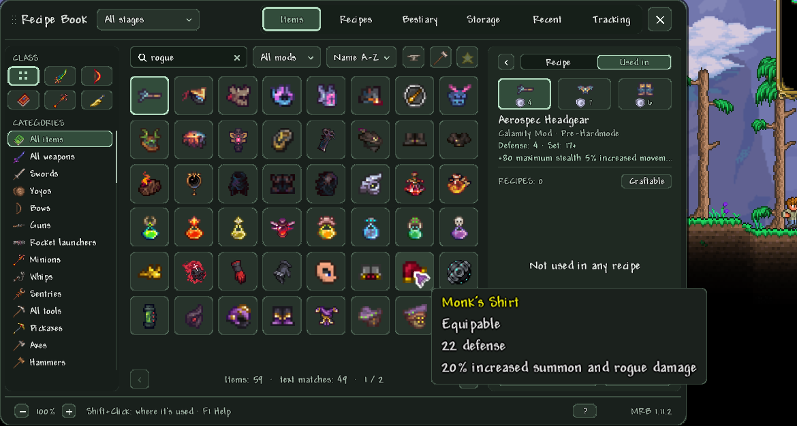

### Quick search (Ctrl+F)

Ctrl+F with the inventory or the book open (in the world Ctrl is Smart Cursor), or the "Search Everything" key you bind in Controls anywhere, opens one search over everything the book knows:

- **items, Storage, recipes, the Bestiary, bosses** ("Before: X"), **tracked goals, categories and mods**, grouped by
  kind; the chips under the field (Tab) narrow it to one of them;
- by **name** in your language, in English or by ID; by **what a thing is**: a category ("buff", "wings"), the buff it
  gives, a trait or a class; and by **descriptions** and Bestiary texts, below the name matches;
- the book's **links** under a match: who drops it, which bag holds it, what a boss drops;
- a **one-click action** on every row: Craft, Take from storage, Track or Open. The preview on the right shows what
  you have, what you can craft, the first sources and every action, with the card's keys (Ctrl+Enter, Alt+T, Alt+F,
  Alt+G, Alt+U);
- **">"** lists the book's commands: Deposit All, Restock, Craftable now, Before the next boss and more.

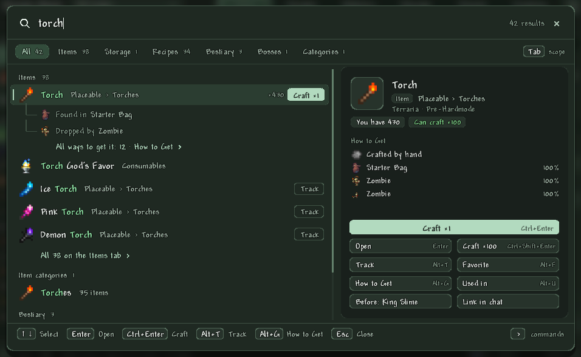

### Links everywhere

Every boss, mob, biome, event, item, mod, stage, trait and goal the book names is a link: hover it to see where it
goes, click to open it, Back to return. A mob's stage, biome, spawns and the bosses in its loot conditions; an item's
stage, mod, recipe conditions and the members of "Any Iron Bar"; How to Get's sellers, Angler, rods and pickaxes; the
tracker and the Tracking tab; the Storage tab's banks, networks and Portable Access.

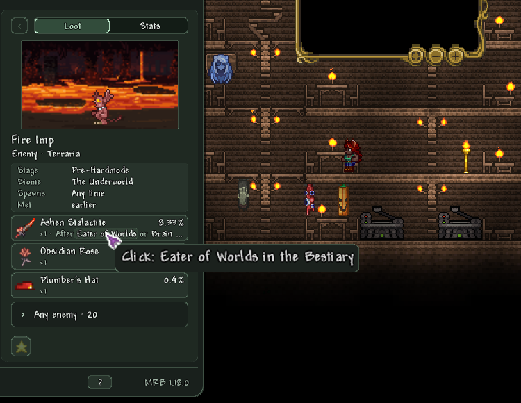

### Sorting

Every sort works both ways (ascending and descending). The sort list adds what makes sense for the category you are
in, and a chosen sort comes back when you return to a category that has it.

| Where | Sorts |
|---|---|
| Every list | Name, ID, Mod, Rarity, Sell price |
| Items and Recipes | Crafting station: weakest or strongest first, by the station the easiest recipe needs |
| Weapons | Damage, Speed, Crit chance, Knockback |
| Ammo | Damage, Knockback |
| Armor and accessories | Defense |
| Wings | Flight time |
| Potions and food | Healing, Mana, Buff duration |
| Tools | Pickaxe power, Axe power, Hammer power |
| Fishing rods and bait | Fishing power, Bait power |
| Bestiary | Stage (earliest first), Met (oldest or newest first) |
| Storage | Changed (what was just stored, taken or crafted with, newest or oldest first) |

Modded rarities, which have no order of their own, are placed after Purple by the value of their items.

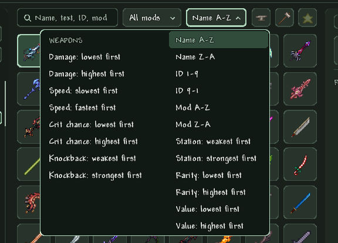
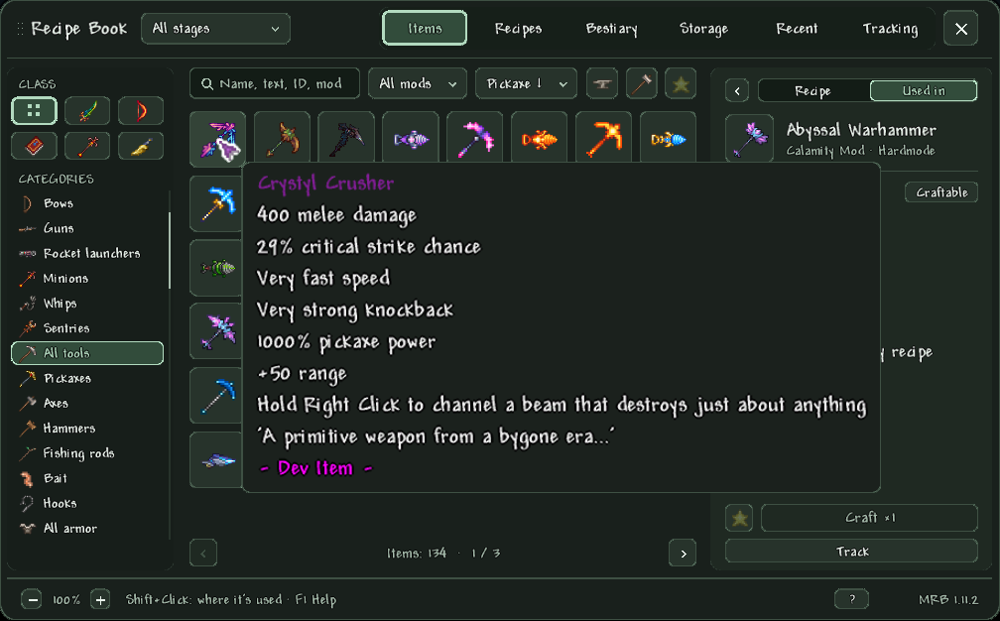

### Progression: stages and "Before: boss"

- Every item, recipe and mob has **the boss it waits for**, in the order of the vanilla and Calamity bosses. The card
  names it ("After Plantera"), and its hint shows why: "Spectre Bar ← Ectoplasm ← drop: Dungeon Spirit".
- The stage is the **earliest** point something can be had, worked out from recipe chains (ingredients, stations and
  conditions all the way down), boss drops and bags, crates, presents, shops and their conditions, enemy drops and
  banners, enemy spawns (post-Plantera Dungeon, eclipse, moons, Martians, pillars, Acid Rain, mods' spawn rules), ores
  and the pickaxe they need, fishing spots and world generation.
- **Stage filter** in the header: All, Pre-Hardmode, Hardmode, Post-Moon Lord, or **"Before: &lt;boss&gt;"** for any
  vanilla or Calamity boss: what you can get or craft with every earlier boss down and that one still alive. The menu
  shows every boss in three columns with its head, the downed ones ticked.
- **"Next boss"** (Alt+5) is the first boss not yet down in your world and moves on by itself when you beat it.
- It works on Items, Recipes, the Bestiary and the card's Used in list. Storage has a stage filter of its own, so
  browsing Hardmode never hides the Pre-Hardmode materials in your chests.
- It follows **your world's difficulty**: Classic, Expert, Master, Journey and Calamity's Revengeance decide which
  drops exist. Something only another difficulty gives says so. "Unknown stage" lists what cannot be placed, and the
  footer counts what the filter hid for that reason.

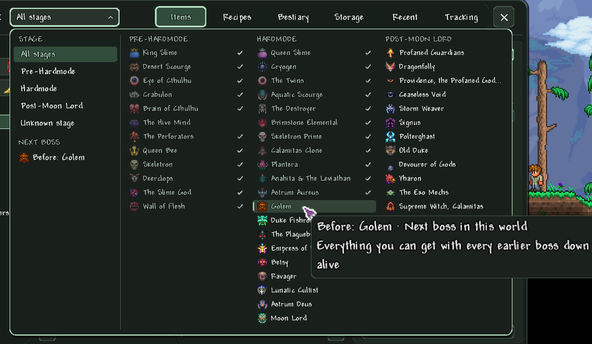

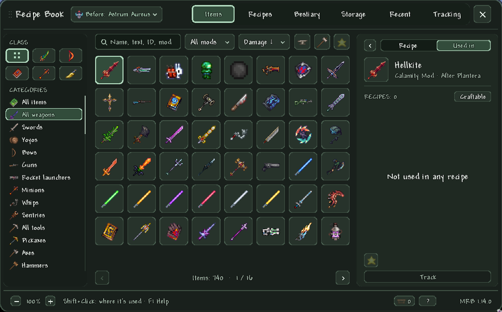
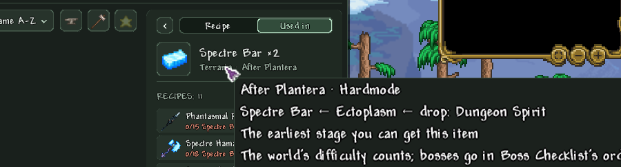

### Class buttons and weapon traits

- **Class buttons**: Melee, Ranged, Magic, Summoner and Rogue (with Calamity) narrow weapons, ammo, armor, accessories
  and buff potions to one class. Armor and accessories are classified by what they actually boost, set bonuses
  included, and Calamity's reworks of vanilla gear are followed (Monk and Shinobi armor count for summoner and rogue).
- **Traits** filter: Homing, Homing stealth strike (Calamity), Pierces, Through walls, Auto attack, Minion, Sentry.
  Tick one or more and only the weapons and ammo with all of them stay; each row says how many listed items have it.
- The card names the item's traits under its name, and the hint says where each comes from: the description's own
  words (quoted), the projectile's stats, or a weapon checked in the game's code. Nothing is guessed: a trait the book
  cannot be sure of is left out.

### Crafting stations and "Craftable"

- **Station filter** (the anvil button): lists the crafting stations of what the other filters show, with how many
  items need each. Untick the ones you lack and whatever only they make is hidden; an item stays while one of its
  recipes needs none of them.
- **Craftable** (the hammer button): only what you can craft right now, from your inventory and nearby storage, at the
  stations in reach. It updates when your materials change and combines with every other filter.
- **Active stations**: a chip in the footer shows the strongest station in reach and how many count. Hover it for their
  icons, grouped: placed nearby, in a Magic Storage Crafting Interface, and surroundings such as water, honey, lava,
  snow or a graveyard. A station that counts only through another (the Adamantite Forge's Furnace) is dimmed with that
  station's icon on its corner.

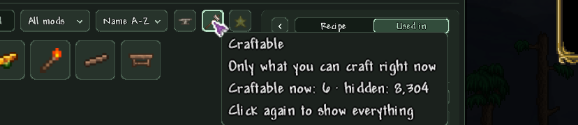

### The item card

- The **recipe** with have/need counts that include your nearby storage, the station and conditions, and whose mod
  the recipe comes from (a vanilla item says Terraria even when another mod changed its recipe).
- **Batches**: x1, x5, x10 and Max (as many as your materials allow, up to 100). **Craft** pulls the missing
  materials out of nearby storage by itself.
- **Recipe variants**: recipes of one item that differ in a single ingredient are one recipe, "Shadow Scale / or
  Tissue Sample"; the row counts the alternative you have most of, and Craft, Max and Track use the one you can make.
- **Used in**: everything the item is crafted into. Click an ingredient or a Used in row to open that item.
- **Contents**: what a Treasure Bag, crate, present or geode holds, with the chances and conditions of your world;
  a bag on a mob card or a container in How to Get opens straight on it.
- **Armor**: the set bonus of the shown combination in the game's own words (Calamity's reworked sets included) and
  every piece of the set; click a piece to switch to it.
- **Track**, **Track Set**, **Favorite** and **How to Get** right on the card.

### How to Get

Every source of an item in one list, each row with its chance and amount:

- **recipes**, with the station;
- **drops** of bosses and enemies, with this world's chance and conditions. Loot only another difficulty or seed
  drops (a boss's own weapons in Expert, which come in its Treasure Bag) is marked "Not in this world" and listed
  last. A condition without a text says whether it holds in your world ("met" or "not met yet");
- **treasure bags, crates, presents and lock boxes**;
- **shops**, the Travelling Merchant included, with their conditions ("NPC lives here", "player carries item");
- **the world itself**: where a plant grows, what breaking blocks, plants and trees drops (by the game's own drop code),
  where to mine an ore or gem and with which pickaxe, fishing spots and quest fish, world chests and structures
  (Calamity's Draedon labs, shrines and the Brimstone Crag included);
- **shimmer**, the **bug net**, **banners**, **trades** and recorded **music boxes**.

An enemy row opens that mob's Bestiary card; a recipe row opens the recipe.

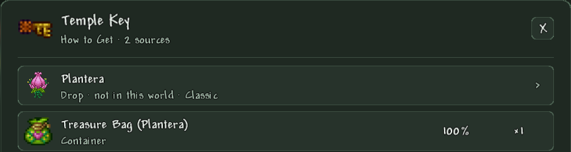

### Nearby storage

- Every unlocked chest and dresser, the Piggy Bank, Safe, Defender's Forge and Void Vault, the open container, a
  carried Void Bag and every Magic Storage network within the radius (10–50 tiles, 30 by default) are **one list** on
  the Storage tab, with search, filters and sorting.
- **Cells line**: "Cells: 1,234 / 3,200", counting Magic Storage cells as Magic Storage's own window does, plus chest
  slots. It turns amber at 90% full; hover it for each network and the chests apart.
- **Take like from a chest**: a click takes the stack onto the cursor, holding right-click takes more and more with
  the game's own speed-up, Shift+Click sends it to the inventory, Ctrl+Click to the trash.
- **Put away**: Shift+Click an inventory item or drop it from the cursor onto the list. It goes onto matching stacks
  first, then into the nearest Magic Storage, then into the nearest chest with room.
- **Deposit All, Quick Stack and Restock** buttons. Deposit All never touches the hotbar, favorites or Magic Storage
  locators; Quick Stack only adds to stacks that are already there and says what went where.
- Card counts, Craftable, Max and the tracker **count all of it**, and Craft takes from it.
- Locked chests, chests another player has open and password networks are **listed as not counted**, with the reason.

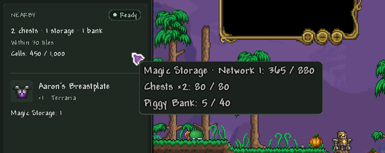
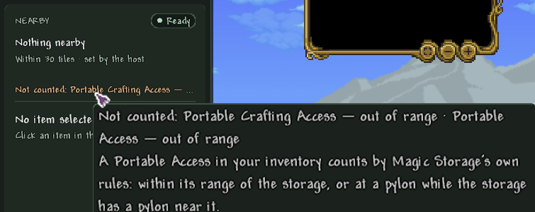

### Magic Storage integration

Magic Storage is fully integrated: the book uses Magic Storage's own members and rules, not a copy of them.

- Every network in reach counts, without connecting or picking one: its items, its storage units' cells (inactive
  units and the unlimited Creative Storage Unit are left out and named), its Crafting Interface stations.
- A bound **Portable Access** in your inventory brings its network in from afar, by Magic Storage's own rules (range,
  pylons, the storage still in place, the password); a **Portable Crafting Access** brings its Crafting Interface's
  stations. A network opened through Magic Storage's window counts too. All of them read "Remote".
- Crafting, tracking, Max and Craftable count the network; Craft pulls from it; deposits go into the nearest network.
- Quick Stack, Deposit All and Restock reach it, the remote one included.
- The **Changed** sort puts what was just stored, taken or crafted with first, whoever moved it, you or another
  player. The times are kept per character and world.
- On a server the server checks the same rules itself and moves the items.

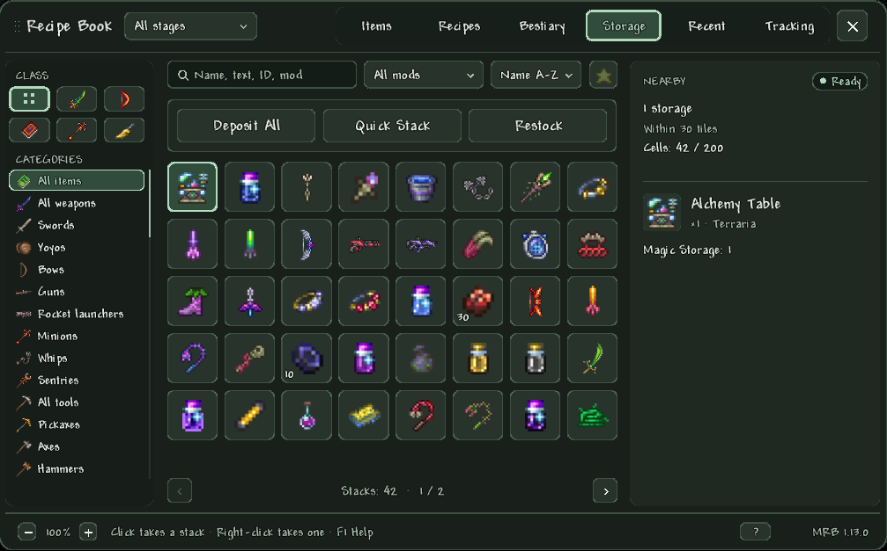
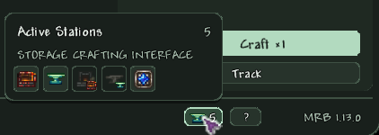

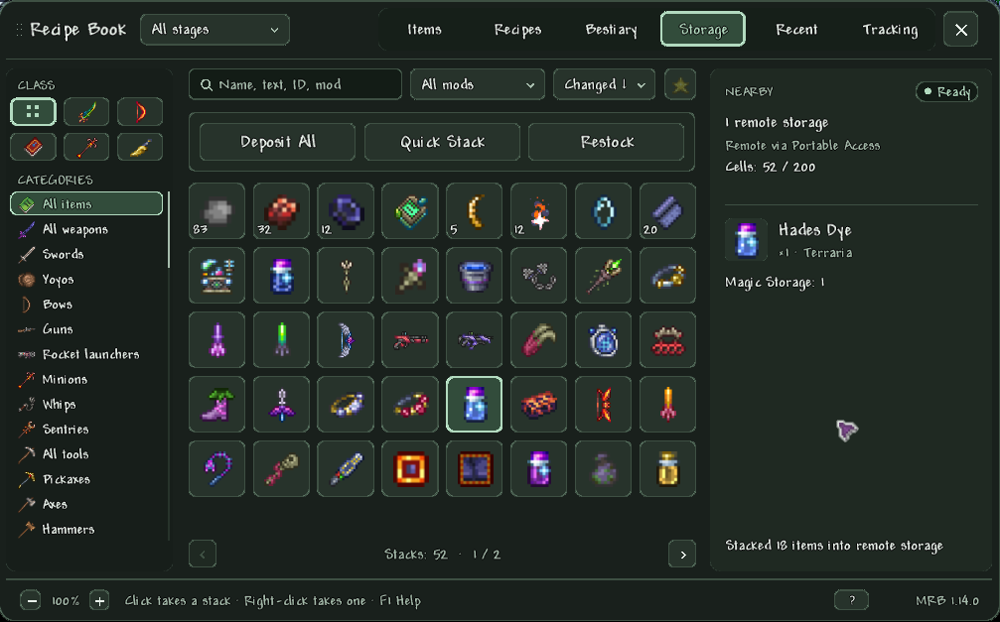
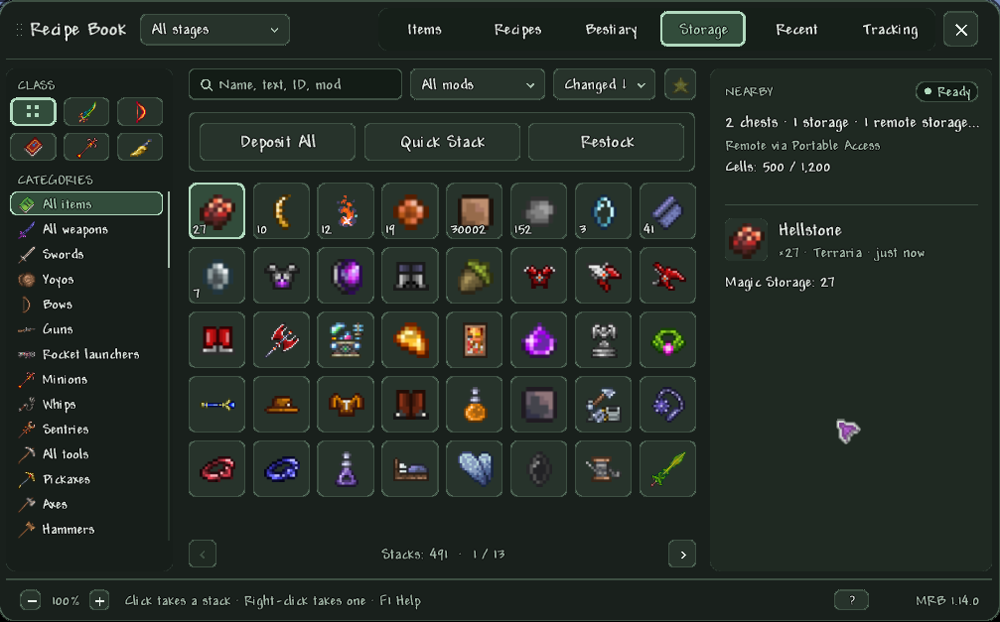

### Calamity integration

Calamity is fully integrated too: bosses, biomes, events and drop rules come from Calamity's own code.

- **Boss order**: every Calamity boss and mini-boss is a progression step, in Calamity's own order with its own
  downed checks. Boss Checklist is not needed.
- **Spawn rules from Calamity's code**: Plaguebringer "Jungle · after Golem", Cryo Slime "Snow · after Cryogen ·
  after any two mechanical bosses", Aero Slime "after The Hive Mind or The Perforator Hive". The **Acid Rain** enemies
  say where and when ("Cragmaw Mire: in water · after Aquatic Scourge") and how the event starts.
- **Biomes**: the Sulphurous Sea, the Abyss layers, the Sunken Sea, the Astral Infection and the Brimstone Crag sort
  the Bestiary; Acid Rain mini-bosses count as mini-bosses.
- **Drops**: Revengeance drops and Calamity's text-less drop conditions are judged against your world.
- **Ores**: those that appear on a boss's first kill (Cryonic, Perennial, Uelibloom, Auric, Exodium and others) name
  that boss and where they generate; Calamity's early-hardmode ore order and its pickaxe requirements (Astral Ore 210,
  Exodium 225) are followed.
- **Rogue**: its own class button, the homing stealth strike trait, and Calamity's reworks of vanilla gear (Monk,
  Shinobi, Gladiator armor, weapon flasks) in the class filter; reworked set bonuses on armor cards.
- **Mob cards** show Calamity's damage reduction.
- Optional **Double-Tap Dash**: double-tap left or right to dash, while Calamity's dash key keeps working.

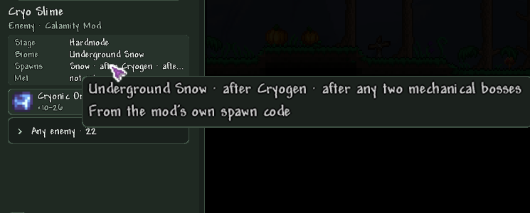

### Bestiary

- Every mob of the game and its mods **by kind** (bosses, mini-bosses, enemies, town NPCs, critters), **event** (Blood
  Moon, eclipse, rain, windy day, blizzard, sandstorm, Halloween, Christmas, party, invasions) and **biome**, with
  search, mod filter, sorting, favorites, the stage filter and "encountered only".
- The card has an **animated portrait over its biome**, its own drops first (with this world's chances; drops any
  enemy can give are folded under "Any enemy"), and **where and after which boss it spawns**, read from the mods' own
  spawn code too.
- Once you have met it, as the vanilla Bestiary requires (enemies after a kill, town NPCs after a chat, critters once
  seen): life, defense, damage, knockback resistance, coins, kills and banner progress. A boss's numbers follow
  Expert/Master and the number of players in the world.
- **Mouse3 on a mob in the world** opens its entry.
- The book records **when you first and last met** each mob: "Recently seen" lists the last 24, and the Bestiary sorts
  by when you met them.

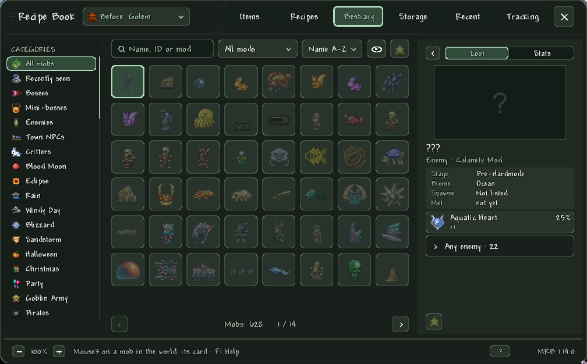
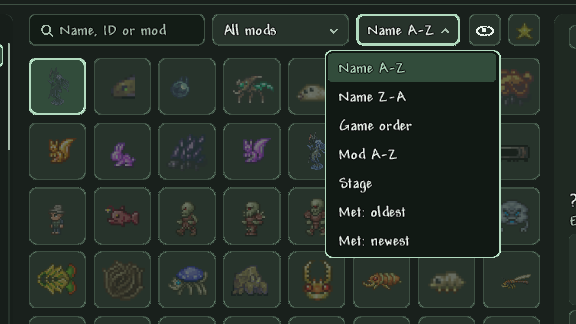

### Tracking

- Track up to **five goals**: an item with its amount, or a whole armor set. Track keeps the book open, so you can add
  several in a row.
- The overlay shows them as **cards with progress bars**, or as **compact lines under the minimap** like an info
  accessory. Counts include your nearby storage.
- The Tracking tab lists each goal's materials; hover one for its own tooltip, "?" opens How to Get.

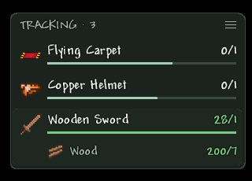
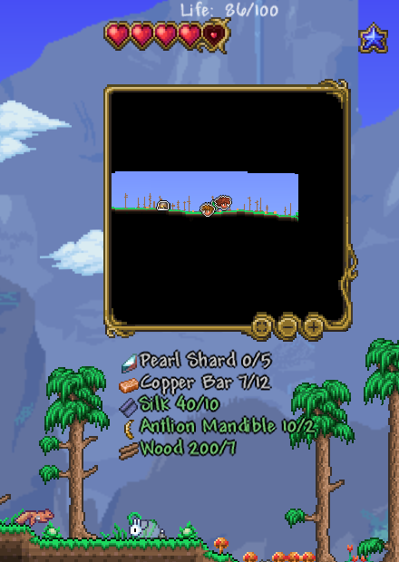

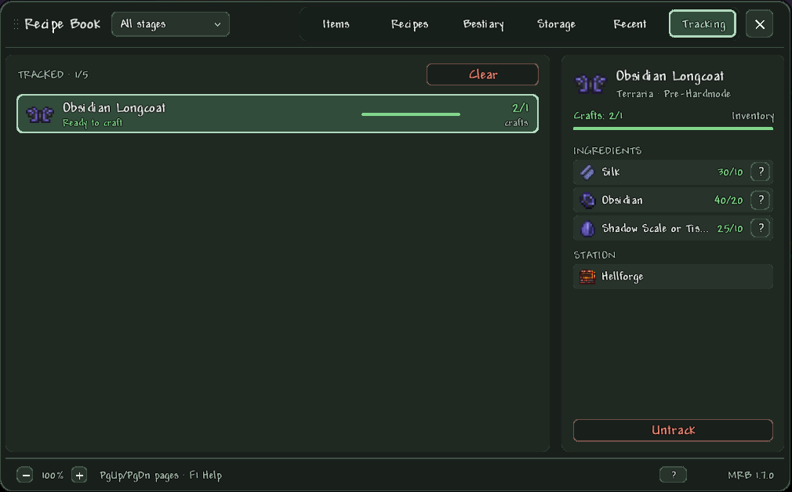

### Map teleport and shared markers

- **Teleport**: Mouse3 on an explored spot of the full map takes you there. Unexplored spots refuse; inside blocks or
  next to lava you land on the nearest safe floor.
- **Shared markers**: right-click the full map to place a marker with an optional name and one of 12 badges. Everyone
  on the server sees it on the full map, the minimap and the overlay, with who placed it and how long ago. Only its
  author or the host can edit or delete it, and it is saved with the world.

### Keyboard and navigation

- **Back and Forward** (Mouse4/Mouse5, Alt+←/→) walk through everything: tabs, filters, selected items, card steps,
  How to Get and enemy cards.
- **Every action has a shortcut**, named in its button's tooltip; F1 shows them all. Arrows move the selection in the
  grid, PgUp/PgDn turn pages, Esc closes the top window only.
- **Hover tooltips** everywhere: any row that stands for an item shows that item's own tooltip; a cut-short value
  shows in full.
- The book's own shortcuts never leak into the game: Ctrl/Alt+digits do not switch the hotbar and quick buff does not
  fire under them.

### Languages

The book speaks English and Russian, including everything it writes about items, sources and mobs, and follows the
game's language setting. With a language it has no translation for, the book's own texts are in English, while item, mob, biome and
mod names come from the game in that language.

**Translate it into your language** the way Calamity is translated: every text of the book, its settings and control
names live in `Localization/<culture>/Mods.ModernRecipeBook.<Area>.hjson`. Copy the `en-US` folder to your language's
folder (`de-DE`, `fr-FR`, `es-ES`, `it-IT`, `pl-PL`, `pt-BR`, `zh-Hans`) and translate the values; whatever you
leave out stays English, so a partial translation already works. Counted texts follow your language's plural rules.
Send it as a pull request or as a translation mod of your own; [TRANSLATING.md](TRANSLATING.md) explains the files,
placeholders and plurals.

## Compatibility

Tested with:

| | Version | |
|---|---|---|
| Terraria | 1.4.4.9 | |
| tModLoader | 2026.08.3.0 (stable) | required |
| Calamity Mod | 2.2.4 | optional, fully supported |
| Magic Storage | 0.7.0.11, with SerousCommonLib 1.0.6.2 | optional, fully supported |

Without Calamity or Magic Storage the book works with whatever the game has. Other mods' items, recipes, drops and
mobs are read the same way as vanilla ones.

## Installation

Subscribe on the [Steam Workshop](https://steamcommunity.com/sharedfiles/filedetails/?id=3827052107), then enable
**Modern Recipe Book** in Workshop → Manage Mods and reload the mods. Players joining a server that has it download it
by themselves.

Without Steam:

1. Download `ModernRecipeBook.tmod` from the [latest release](../../releases/latest).
2. Put it into `Documents/My Games/Terraria/tModLoader/Mods`.
3. Enable **Modern Recipe Book** in Workshop → Manage Mods and reload the mods.

On a server, install the same file on the server and on every client.

## Controls

Open the book with **Mouse3** (rebindable in Controls). With the inventory open, Mouse3 on an item in any slot opens
that item.

<b>All shortcuts</b>

| Moving around | |
|---|---|
| Ctrl+1…6 | Go to a tab |
| Ctrl+Tab | Next tab |
| Mouse4 · Alt+← | Back |
| Mouse5 · Alt+→ | Forward |
| ← ↑ → ↓ | Move the selection |
| PgUp · PgDn | Turn pages |
| Home · End | First · last page |
| Esc | Close the top window |
| F1 | Help |

| The item card | |
|---|---|
| Ctrl+Enter | Craft |
| Ctrl+Shift+Enter | Craft the most |
| Alt+T | Track |
| Alt+F | Favorite |
| Alt+G | How to Get |
| Alt+U | Recipe · Used in · Contents (on a mob: Loot · Stats) |
| LMB | Open an ingredient |
| Shift+LMB | Where it's used |
| Alt+LMB | Favorite in the grid |
| Mouse3 | Look up the item or mob under the cursor |

| Finding things | |
|---|---|
| Ctrl+F | Quick search (inventory or book open) |
| Ctrl+Backspace | Reset filters |
| Alt+1…5 | Stage (5: before the next boss) |
| F5 | Refresh |

| Storage | |
|---|---|
| LMB | Take a stack |
| RMB, hold | One at a time |
| Shift+LMB | Stack to inventory |
| Ctrl+LMB | To the trash |
| Ctrl+Enter | Selected to inventory |
| Ctrl+Q · Ctrl+R | Quick stack · restock |
| Shift+LMB in inventory | Put a stack in |
| LMB holding an item | Put the held item in |

| Full map | |
|---|---|
| Mouse3 | Teleport there |
| RMB | Place a marker |
| RMB on a marker | Edit or delete it |

## Configuration

Mod Configuration → **Recipe Book** (yours) and **Recipe Book: Server** (the host's).

| Option | Default | |
|---|---|---|
| Window Size | 90% | Shrinks the book to fit small screens |
| Text Size | 100% | Text only, not the window |
| Middle-Click Item Search | on | Mouse3 on an item in any slot opens it in the book |
| Tracking Cards Opacity / Size | 90% / 100% | The tracking overlay's panel |
| Tracking Overlay: Compact Lines | off | Material lines under the minimap instead of cards |
| Double-Tap Dash (Calamity) | off | Double-tap left or right to dash |
| **Server:** Nearby Storage | on | Show, count and craft from chests and Magic Storage in the radius |
| **Server:** Nearby Storage Radius | 30 tiles | 10–50 tiles |
| **Server:** Map Teleport | on | Mouse3 on the full map |
| **Server:** Shared Map Markers | on | Markers everyone on the server sees, kept with the world |

## Multiplayer

The mod is Both-sided and built for servers, Host & Play included; players joining download it.

- Taking from and putting into storage is carried out by the server, which checks every request; holding right-click
  is batched so it never runs into the server's rate limit.
- Map markers are shared and kept with the world; only their author or the host can change them.
- Spawn rules and world sources are read on clients the same way as in single player.
- The host decides in **Recipe Book: Server** whether nearby storage, map teleport and markers are on.

## Building from source

1. Clone the repository into `Documents/My Games/Terraria/tModLoader/ModSources/ModernRecipeBook`. The folder must be
   named `ModernRecipeBook`: tModLoader takes the mod's name from it.
2. In tModLoader open Workshop → Develop Mods and press **Build** next to Modern Recipe Book, or run `dotnet build` in
   the folder.

## Repository layout

| Path | |
|---|---|
| `ModernRecipeBook.csproj` | The project; tModLoader builds the mod from this folder |
| `build.txt`, `description.txt`, `icon.png` | The mod's metadata, as tModLoader reads them |
| `src/ModernRecipeBook.cs` | The mod class and its network messages |
| `src/UI/` | The book itself (`Book`: the window, its tabs, cards and help) and its drawing (`Drawing`) |
| `src/Catalogue/` | What the book knows about items: categories, classes, weapon traits, armor sets, recipes, search |
| `src/Sources/` | How to Get: drops, bags, shops, the world |
| `src/Progression/` | Stages and bosses, spawn rules |
| `src/Mobs/` | The Bestiary |
| `src/Storage/` | Nearby storage, Magic Storage, crafting from storage, the server side |
| `src/Tracking/`, `src/Recent/`, `src/WorldMap/` | Tracking, recent crafts, map teleport and markers |
| `src/Common/` | Configs, the player, input, and `BookText` (localization) |
| `Localization/` | English and Russian texts |
| `Assets/` | Textures |
| `docs/` | Design notes of the larger features and the README screenshots (kept out of the `.tmod`) |
| `.github/workflows/` | The build and release workflow |

## Contributing

Bugs and ideas go to [Issues](../../issues). For a bug, say what you did, what you expected and what happened, with
your tModLoader, Calamity and Magic Storage versions and `tModLoader-Logs/client.log`. Pull requests are welcome;
user-facing text comes in both English and Russian, and every release gets a CHANGELOG entry.

## Changelog

Every release is in [CHANGELOG.md](CHANGELOG.md), newest first. The versions follow
[Semantic Versioning](https://semver.org/).

## License

Modern Recipe Book is free software under the [GNU General Public License v3.0](LICENSE). You may use, change and
share it, including a modified version of your own, as long as what you share stays under the same license with its
source available.

Copyright (C) 2026 h8suga

## Credits

- Made by [h8suga](https://github.com/h8suga).
- [psychological1nstability](https://github.com/psychological1nstability) laid the foundation of the mod.
- Built on [tModLoader](https://github.com/tModLoader/tModLoader).
- Integrates with [Calamity Mod](https://steamcommunity.com/sharedfiles/filedetails/?id=2824688072) and
  [Magic Storage](https://steamcommunity.com/sharedfiles/filedetails/?id=2563309347); both belong to their authors.
