

<h1 align="center">Modern Recipe Book</h1>

Книга рецептов, бестиарий и обзор хранилищ для каждого предмета и моба Terraria и её модов, для tModLoader.

<a href="README.md">English</a> · <b>Русский</b>

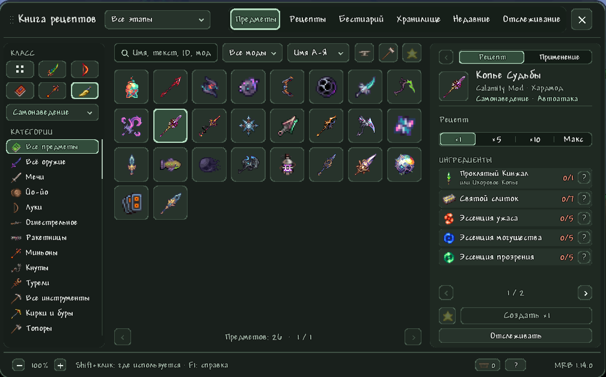

Нажми **Mouse3** (колёсико), и поверх игры откроется книга. В ней каждый предмет и моб игры и всех загруженных модов,
прочитанные из самой игры, а не из вики: рецепты, добыча, мешки, магазины, ящики, рыбалка, генерация мира и правила
появления. Она отвечает на вопросы *что это*, *где это взять*, *когда в игре это можно получить* и *могу ли я сделать
это прямо сейчас из того, что у меня есть*.

## Содержание

- [О проекте](#о-проекте)
- [Зачем она нужна](#зачем-она-нужна)
- [Возможности](#возможности)
  - [Шесть вкладок](#шесть-вкладок)
  - [Поиск, категории и избранное](#поиск-категории-и-избранное)
  - [Сортировки](#сортировки)
  - [Прогрессия: этапы и «До: босс»](#прогрессия-этапы-и-до-босс)
  - [Классы и свойства оружия](#классы-и-свойства-оружия)
  - [Станции крафта и «Можно создать»](#станции-крафта-и-можно-создать)
  - [Карточка предмета](#карточка-предмета)
  - [Где взять](#где-взять)
  - [Хранилище рядом](#хранилище-рядом)
  - [Интеграция с Magic Storage](#интеграция-с-magic-storage)
  - [Интеграция с Calamity](#интеграция-с-calamity)
  - [Бестиарий](#бестиарий)
  - [Отслеживание](#отслеживание)
  - [Телепорт по карте и общие метки](#телепорт-по-карте-и-общие-метки)
  - [Клавиатура и навигация](#клавиатура-и-навигация)
  - [Языки](#языки)
- [Совместимость](#совместимость)
- [Установка](#установка)
- [Управление](#управление)
- [Настройки](#настройки)
- [Мультиплеер](#мультиплеер)
- [Сборка из исходников](#сборка-из-исходников)
- [Устройство репозитория](#устройство-репозитория)
- [Участие в разработке](#участие-в-разработке)
- [История изменений](#история-изменений)
- [Авторы](#авторы)

## О проекте

Я сделал Modern Recipe Book для себя: не нашёл мода на рецепты и хранилища, который был бы одновременно удобным и
приятным на вид. Это личный проект, поэтому регулярных обновлений не обещаю, и он зависит от версий tModLoader,
Calamity и Magic Storage, на которых собран и проверен (см. [Совместимость](#совместимость)); новая версия любого
из них может что-то сломать.

Зато это хорошая основа, чтобы развивать дальше: исходники, заметки по устройству в [docs](docs/) и автоматическая
сборка — всё здесь. Форки и pull request'ы приветствуются.

## Зачем она нужна

- **Без вкладки с вики.** Каждый источник прочитан из игры и её модов, поэтому модовые предметы, рецепты, изменённые
  другими модами, и сложность твоего мира всегда учтены верно.
- **Знает, где ты в игре.** У каждого предмета, рецепта и моба есть босс, которого он ждёт; «До: &lt;босс&gt;»
  показывает ровно то, что можно получить сейчас, а «Следующий босс» сам следит за твоим миром.
- **Крафтит из всего, что вокруг**: инвентарь, сундуки, копилки и Magic Storage, даже далёкая сеть.
- **Полностью интегрирована с Magic Storage и Calamity**, прочитанными из их собственного кода.
- **Наведи на что угодно**, что обозначает предмет, и увидишь его подсказку; каждый счётчик говорит, откуда он.
- **Каждый фильтр остаётся**, пока ты его не сменишь, у каждой вкладки свой, а «Назад»/«Вперёд» проходят по всему, что
  ты делал.
- **Готова к мультиплееру**, быстрая (тяжёлые данные строятся небольшими шагами, пока книга открыта) и полностью на
  русском и английском.

## Возможности

### Шесть вкладок

| Вкладка | Что в ней |
|---|---|
| **Предметы** | Каждый предмет с карточкой: рецепт, применение, где взять |
| **Рецепты** | Каждый рецепт отдельной строкой; рецепты, отличающиеся одним материалом, — одной |
| **Бестиарий** | Каждый моб игры и её модов с добычей, появлением и характеристиками |
| **Хранилище** | Всё, что лежит в сундуках, копилках и сетях Magic Storage рядом |
| **Недавние** | Что ты недавно создал |
| **Отслеживание** | Предметы и комплекты брони, за которыми ты следишь, с недостающими материалами |

Ctrl+1…6 открывает вкладку, Ctrl+Tab — следующую.

### Поиск, категории и избранное

- **Поиск** по названию, ID, моду или тексту самого предмета, как его показывает игра со всеми правками модов:
  «разбойник» найдёт Рубаху монаха и фляги для оружия. Сначала совпадения по названию, потом по тексту; на счётчике
  страниц видно, сколько найдено по тексту. Строки характеристик («50 урона разбойника») пропускаются, чтобы не
  забивать остальное.
- **Фильтр по модам**: в списке только моды, у которых что-то есть на открытой вкладке.
- **Категории** с иконками: оружие (мечи, йо-йо, луки, огнестрел, ракетницы, миньоны, кнуты, турели), инструменты
  (кирки, топоры, молоты, удочки, наживка, крюки), броня (шлемы, нагрудники, поножи, украшения), аксессуары, крылья,
  боеприпасы (стрелы, пули, ракеты), размещаемое (блоки, платформы, стены, мебель, станции, сундуки, двери, стулья,
  столы, источники света, факелы, проводка), зелья (лечения, маны, усиления, еда и напитки), питомцы, световые питомцы,
  транспорт, вагонетки, красители, краски для волос, призыв боссов, мешки с сокровищами, ящики рыбака, существа,
  материалы, руды, слитки, самоцветы, Экстрактинатор, эксперт, мастер и расходуемое.
- **Избранное**: Alt+клик по предмету в сетке или Alt+F на карточке, и фильтр по избранному.
- Поиск, мод, категория, избранное, сортировка и этап **хранятся у каждой вкладки** и сами не сбрасываются: ни при
  закрытии книги, ни при переходе к другому предмету. Ctrl+Backspace очищает открытую вкладку.

### Сортировки

Каждая сортировка работает в обе стороны (по возрастанию и убыванию). Список сортировок добавляет то, что имеет смысл
для открытой категории, а выбранная сортировка возвращается, когда ты снова в категории, где она есть.

| Где | Сортировки |
|---|---|
| Любой список | Название, ID, мод, редкость, цена продажи |
| Предметы и рецепты | Станция крафта: от слабой или от сильной, по станции самого простого рецепта |
| Оружие | Урон, скорость, шанс крита, отбрасывание |
| Боеприпасы | Урон, отбрасывание |
| Броня и аксессуары | Защита |
| Крылья | Время полёта |
| Зелья и еда | Лечение, мана, длительность эффекта |
| Инструменты | Сила кирки, топора, молота |
| Удочки и наживка | Сила рыбалки, сила наживки |
| Бестиарий | Этап (раньше — выше), встреча (сначала старые или новые) |
| Хранилище | «Изменено»: что только что положили, взяли или потратили на крафт, сначала новые или старые |

Модовые редкости, у которых нет своего порядка, стоят после фиолетовой, по стоимости своих предметов.

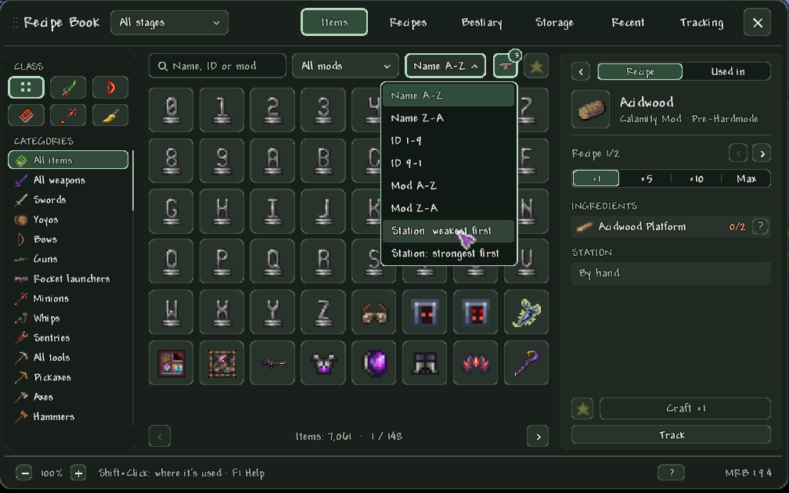

### Прогрессия: этапы и «До: босс»

- У каждого предмета, рецепта и моба есть **босс, которого он ждёт**, в порядке боссов игры и Calamity. Карточка
  называет его («После: Плантера»), а подсказка объясняет почему: «Спектральный слиток ← Эктоплазма ← добыча: Дух
  темницы».
- Этап — **самый ранний** момент, когда что-то можно получить. Он выводится из цепочек рецептов (материалы, станции и
  условия до самого низа), добычи и мешков боссов, ящиков, подарков, магазинов с их условиями, добычи врагов и знамён,
  появления врагов (темница после Плантеры, затмение, луны, марсиане, столпы, Кислотный дождь, правила появления
  модов), руд и нужной для них кирки, мест рыбалки и генерации мира.
- **Фильтр по этапу** в шапке: все, до хардмода, хардмод, после Лунного лорда или **«До: &lt;босс&gt;»** для любого
  босса игры и Calamity: что можно получить или создать, когда все боссы до него побеждены, а он ещё жив. В меню
  все боссы в три столбца с головами, побеждённые отмечены.
- **«Следующий босс»** (Alt+5) — первый ещё не побеждённый босс твоего мира; после победы фильтр сам переходит к
  следующему.
- Работает на «Предметах», «Рецептах», в бестиарии и в «Применении» на карточке. У «Хранилища» свой фильтр этапа,
  поэтому просмотр хардмода не прячет материалы до хардмода в твоих сундуках.
- Учитывает **сложность твоего мира**: обычная, эксперт, мастер, путешествие и Revengeance из Calamity решают, какая
  добыча существует. То, что даёт только другая сложность, так и подписано. «Этап неизвестен» показывает, что
  определить не удалось, а подвал считает, сколько фильтр из-за этого скрыл.

### Классы и свойства оружия

- **Кнопки классов**: ближний бой, стрелок, маг, призыватель и разбойник (с Calamity) оставляют оружие, боеприпасы,
  броню, аксессуары и зелья усиления одного класса. Броня и аксессуары распределены по тому, что они на самом деле
  усиливают, с бонусами комплектов, и с учётом переделок ванильных вещей в Calamity (броня монаха и шиноби — для
  призывателя и разбойника).
- **Свойства оружия**: самонаведение, самонаводящийся удар из скрытности (Calamity), пробивание, сквозь стены,
  автоатака, миньон, турель. Отметь одно или несколько, и останутся только оружие и боеприпасы со всеми ними; у каждой
  строки видно, сколько предметов в списке её имеют.
- Карточка называет свойства предмета под его названием, а подсказка говорит, откуда каждое: собственные слова
  описания (в кавычках), параметры снаряда или оружие, проверенное в коде игры. Ничего не угадывается: свойство, в
  котором книга не уверена, не указывается.

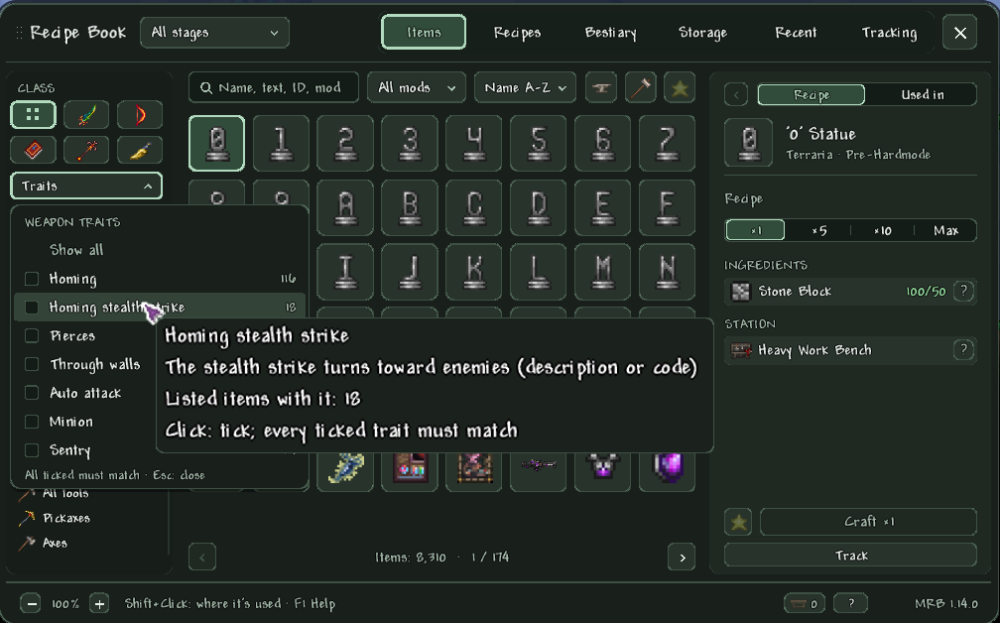
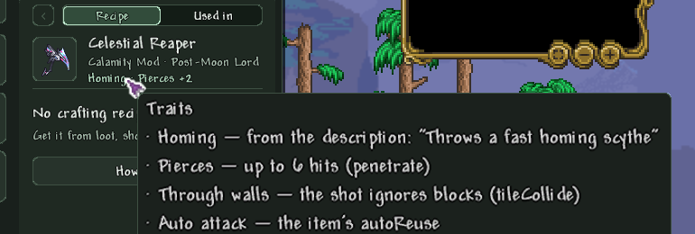

### Станции крафта и «Можно создать»

- **Фильтр станций** (кнопка с наковальней): станции крафта того, что показывают остальные фильтры, и сколько
  предметов требует каждая. Сними галочки со станций, которых у тебя нет, и пропадёт то, что делается только на них;
  предмет остаётся, пока хоть один его рецепт обходится без них.
- **«Можно создать»** (кнопка с молотом): только то, что можно сделать прямо сейчас из инвентаря и хранилища рядом, на
  станциях в досягаемости. Обновляется, когда меняются материалы, и сочетается со всеми фильтрами.
- **Активные станции**: значок в подвале показывает самую сильную станцию в досягаемости и сколько их всего. Наведи —
  появятся их иконки по группам: рядом, в Crafting Interface из Magic Storage и окружение вроде воды, мёда, лавы,
  снега или кладбища. Станция, которая считается только через другую (печь у Адамантитовой кузни), приглушена, а
  на её углу иконка той станции.

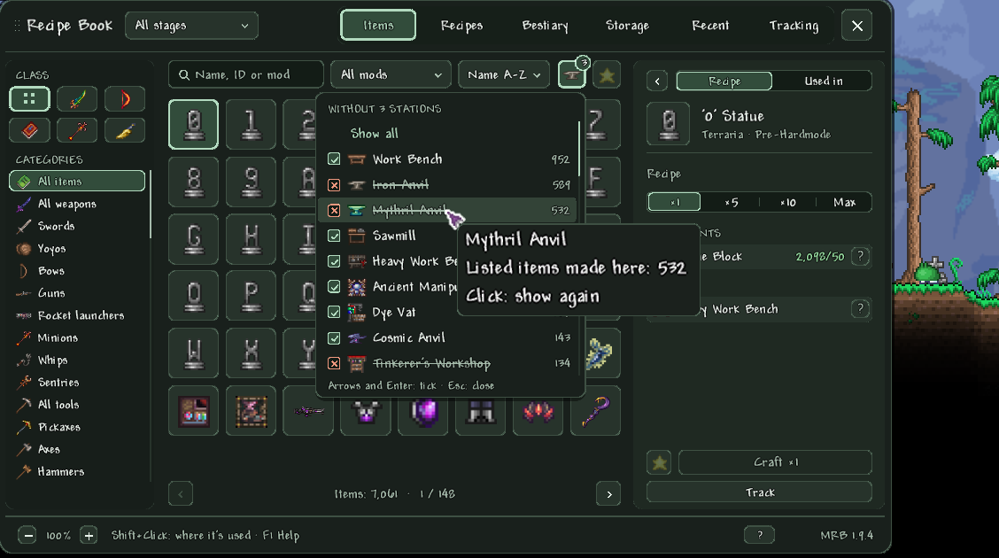
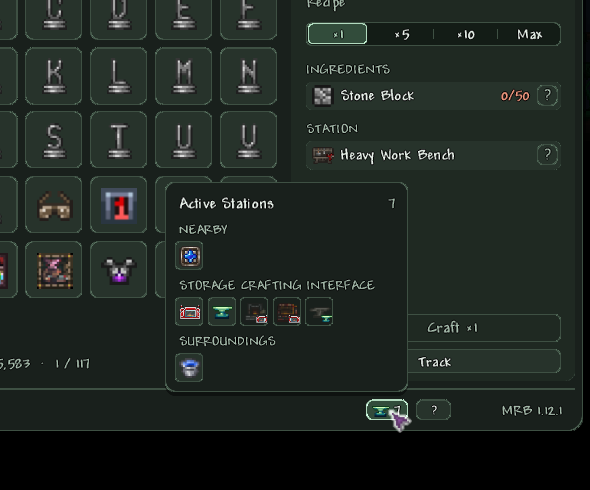

### Карточка предмета

- **Рецепт** со счётчиками «есть/нужно», которые учитывают хранилище рядом, станцию и условия, и мод, из которого
  рецепт (ванильный предмет пишет Terraria, даже если рецепт поменял другой мод).
- **Партии**: x1, x5, x10 и Макс (сколько хватит материалов, до 100). **«Создать»** само достаёт недостающие материалы
  из хранилища рядом.
- **Варианты рецепта**: рецепты одного предмета, отличающиеся одним материалом, — один рецепт, «Теневая чешуя / или
  Образец ткани»; строка считает тот вариант, которого у тебя больше всего, а «Создать», «Макс» и «Отслеживать» берут
  тот, что можно сделать.
- **«Применение»**: всё, что из предмета делается. Клик по материалу или строке применения открывает тот предмет.
- **Броня**: бонус показанного комплекта словами самой игры (с переделанными в Calamity комплектами) и каждая его
  часть; клик по части переключает на неё.
- **«Отслеживать»**, **«Отслеживать комплект»**, **«Избранное»** и **«Где взять»** прямо на карточке.

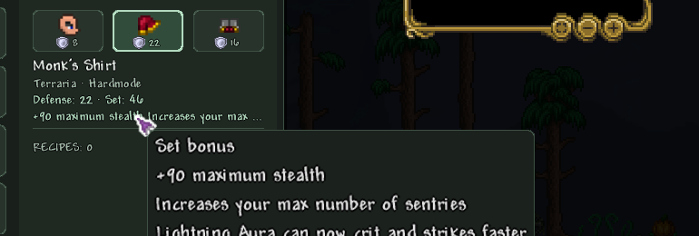

### Где взять

Все источники предмета одним списком, у каждой строки шанс и количество:

- **рецепты** со станцией;
- **добыча** боссов и врагов с шансом и условиями для этого мира. Добыча, которая падает только в другой сложности или
  на другом сиде (собственное оружие босса в эксперте, которое лежит в его мешке), подписана «Не в этом мире» и стоит в
  конце. Условие без текста говорит, выполнено ли оно в твоём мире («выполнено» или «пока не выполнено»);
- **мешки с сокровищами, ящики, подарки и запертые шкатулки**;
- **магазины**, включая Странствующего торговца, с их условиями («NPC живёт здесь», «у игрока есть предмет»);
- **сам мир**: где растёт растение, что выпадает из блоков, растений и деревьев (по собственному коду добычи игры), где
  копать руду или самоцвет и какой киркой, места рыбалки и рыба для заданий, сундуки и постройки мира (с лабораториями
  Дрейдона, святилищами и Серными скалами Calamity);
- **мерцание**, **сачок**, **знамёна**, **обмен** и запись **музыкальных шкатулок**.

Строка врага открывает его карточку в бестиарии, строка рецепта — рецепт.

### Хранилище рядом

- Каждый незапертый сундук и комод, копилка, сейф, Кузница защитника и Пустотный сейф, открытый контейнер, Пустотная
  сумка в инвентаре и каждая сеть Magic Storage в радиусе (10–50 блоков, по умолчанию 30) — **один список** на вкладке
  «Хранилище» с поиском, фильтрами и сортировкой.
- **Строка ячеек**: «Ячейки: 1 234 / 3 200» — ячейки Magic Storage считаются так же, как в окне самого Magic Storage,
  плюс слоты сундуков. На 90% заполнения строка становится янтарной; наведи — увидишь каждую сеть и сундуки отдельно.
- **Брать как из сундука**: клик берёт стопку на курсор, зажатая правая кнопка берёт всё больше с ускорением самой
  игры, Shift+клик — в инвентарь, Ctrl+клик — в корзину.
- **Убрать**: Shift+клик по предмету в инвентаре или перенос с курсора на список. Предмет ложится сначала к таким же
  стопкам, потом в ближайший Magic Storage, потом в ближайший сундук с местом.
- Кнопки **«Сложить всё», «Быстрый стак» и «Пополнить»**. «Сложить всё» не трогает хотбар, избранное и локаторы Magic
  Storage; «Быстрый стак» только доливает к уже лежащим стопкам и пишет, что куда ушло.
- Счётчики карточки, «Можно создать», «Макс» и трекер **считают всё это**, а «Создать» берёт оттуда.
- Запертые сундуки, сундуки, открытые другим игроком, и сети с паролем **перечислены как неучтённые**, с причиной.

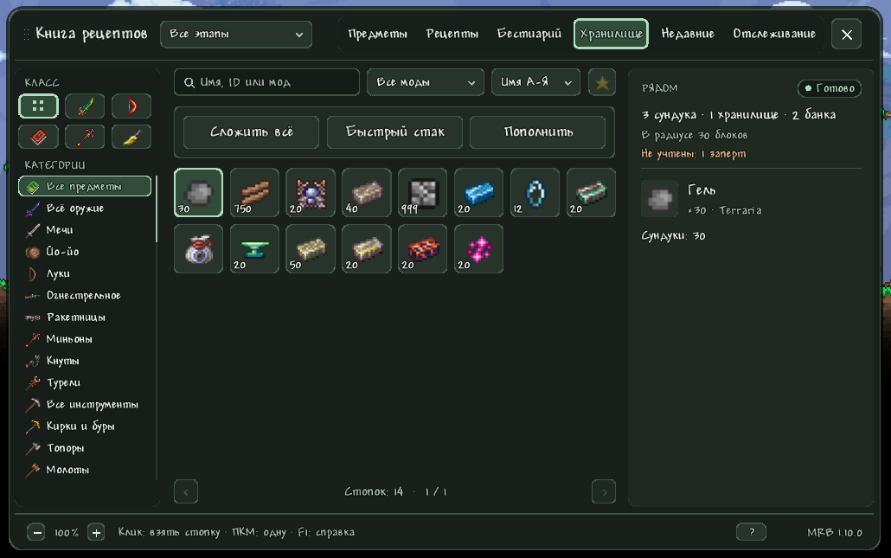

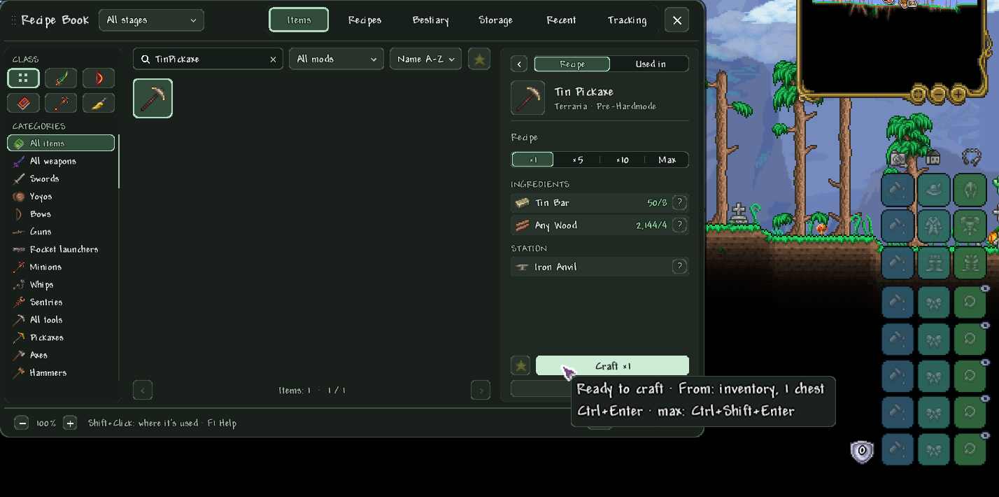

### Интеграция с Magic Storage

Magic Storage интегрирован полностью: книга пользуется собственными методами и правилами Magic Storage, а не их копией.

- Каждая сеть в досягаемости учитывается без подключения и выбора: её предметы, ячейки её блоков (неактивные блоки и
  безлимитный Creative Storage Unit не считаются и называются), станции её Crafting Interface.
- Привязанный **Portable Access** в инвентаре добавляет свою сеть издалека по правилам самого Magic Storage (дальность,
  пилоны, хранилище на месте, пароль); **Portable Crafting Access** добавляет станции своего Crafting Interface. Сеть,
  открытая через окно Magic Storage, тоже учитывается. Все такие сети подписаны «Удалённо».
- Крафт, отслеживание, «Макс» и «Можно создать» считают сеть; «Создать» берёт из неё; предметы складываются в
  ближайшую сеть.
- «Быстрый стак», «Сложить всё» и «Пополнить» достают до неё, в том числе до удалённой.
- Сортировка **«Изменено»** ставит первым то, что только что положили, взяли или потратили на крафт, кто бы это ни
  сделал — ты или другой игрок. Время хранится у персонажа для каждого мира.
- На сервере сам сервер проверяет те же правила и переносит предметы.

### Интеграция с Calamity

Calamity тоже интегрирован полностью: боссы, биомы, события и правила добычи берутся из кода самого Calamity.

- **Порядок боссов**: каждый босс и мини-босс Calamity — шаг прогрессии, в порядке самого Calamity и с его проверками
  победы. Boss Checklist не нужен.
- **Правила появления из кода Calamity**: Разносчик чумы «Джунгли · после Голема», Ледяной слизень «Снег · после
  Криогена · после любых двух механических боссов», Воздушный слизень «после Разума улья или Улья перфораторов». Враги
  **Кислотного дождя** говорят, где и когда появляются («Трясинный дробитель: в воде · после Водного бича»), и как
  начинается событие.
- **Биомы**: Сернистое море, слои Бездны, Затонувшее море, Астральная зараза и Серные скалы разбивают бестиарий;
  мини-боссы Кислотного дождя считаются мини-боссами.
- **Добыча**: добыча Revengeance и условия Calamity без текста проверяются по твоему миру.
- **Руды**: те, что появляются после первого убийства босса (Cryonic, Perennial, Uelibloom, Auric, Exodium и другие),
  называют этого босса и где генерируются; учтён порядок руд раннего хардмода Calamity и требования к кирке
  (астральная руда 210, экзодиум 225).
- **Разбойник**: своя кнопка класса, свойство «самонаводящийся удар из скрытности» и переделки ванильных вещей в
  Calamity (броня монаха, шиноби, гладиатора, фляги для оружия) в фильтре классов; переделанные бонусы комплектов на
  карточках брони.
- **Карточки мобов** показывают снижение урона Calamity.
- Необязательный **рывок двойным нажатием**: двойное нажатие влево или вправо — рывок, а клавиша рывка Calamity
  продолжает работать.

### Бестиарий

- Каждый моб игры и её модов **по виду** (боссы, мини-боссы, враги, жители, существа), **событию** (Кровавая луна,
  затмение, дождь, ветреный день, метель, песчаная буря, Хэллоуин, Рождество, вечеринка, вторжения) и **биому**, с
  поиском, фильтром по модам, сортировкой, избранным, фильтром этапа и «только встреченные».
- В карточке **анимированный портрет на фоне биома**, сначала собственная добыча (с шансами этого мира; то, что может
  выпасть с любого врага, свёрнуто в «Любые враги») и **где и после какого босса он появляется**, прочитанное и из кода
  появления модов.
- После встречи, как требует ванильный бестиарий (враги — после убийства, жители — после разговора, существа — когда
  увидишь): здоровье, защита, урон, сопротивление отбрасыванию, монеты, убийства и прогресс знамени. Числа босса
  учитывают эксперт/мастер и число игроков в мире.
- **Mouse3 по мобу в мире** открывает его карточку.
- Книга записывает, **когда ты впервые и в последний раз встретил** каждого моба: «Недавно встреченные» показывают
  последних 24, а бестиарий сортируется по времени встречи.

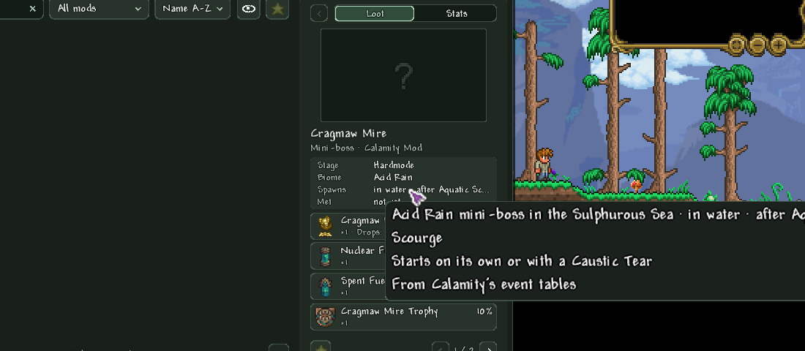
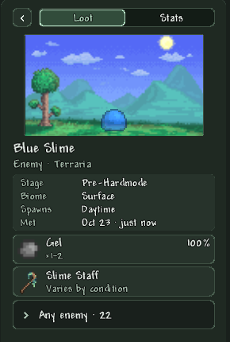

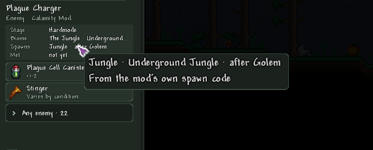

### Отслеживание

- До **пяти целей**: предмет с нужным количеством или целый комплект брони. «Отслеживать» не закрывает книгу, так что
  можно добавить несколько подряд.
- Оверлей показывает их **карточками с полосками прогресса** или **компактными строками под мини-картой**, как
  информационный аксессуар. Счётчики учитывают хранилище рядом.
- Вкладка «Отслеживание» перечисляет материалы каждой цели; наведи на материал — увидишь его подсказку, «?» открывает
  «Где взять».

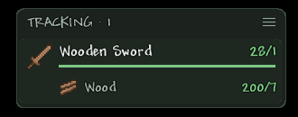

### Телепорт по карте и общие метки

- **Телепорт**: Mouse3 по исследованному месту большой карты переносит тебя туда. В неисследованное место нельзя;
  если там блоки или рядом лава, ты окажешься на ближайшем безопасном полу.
- **Общие метки**: ПКМ по большой карте ставит метку с необязательным названием и одним из 12 значков. Её видят все на
  сервере — на большой карте, мини-карте и оверлее, — с тем, кто и когда её поставил. Менять и удалять её может только
  автор или хост, хранится она вместе с миром.

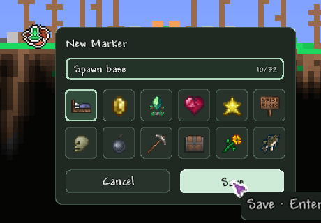
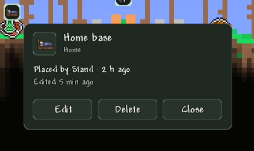

### Клавиатура и навигация

- **«Назад» и «Вперёд»** (Mouse4/Mouse5, Alt+←/→) проходят по всему: вкладки, фильтры, выбранные предметы, шаги
  карточки, «Где взять» и карточки врагов.
- **У каждого действия есть сочетание**, его называет подсказка кнопки; F1 показывает все. Стрелки двигают выбор в
  сетке, PgUp/PgDn листают страницы, Esc закрывает только верхнее окно.
- **Подсказки при наведении** везде: любая строка, которая обозначает предмет, показывает подсказку самого предмета;
  обрезанное значение видно целиком.
- Сочетания книги не протекают в игру: Ctrl/Alt+цифры не переключают хотбар, а быстрые усиления под ними не
  срабатывают.

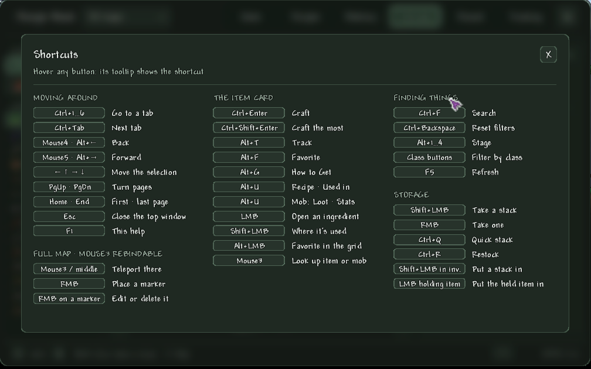

### Языки

Книга говорит на русском и английском, включая всё, что она пишет о предметах, источниках и мобах, а язык берёт из
настроек игры. На любом другом языке собственные тексты книги идут на английском, а названия предметов, мобов,
биомов и модов игра даёт на этом языке.

Настройки мода и названия клавиш лежат в `Localization/*.hjson` и переводятся обычным для tModLoader способом.
Собственные тексты книги пока встроены в код парами «английский/русский», поэтому для полного перевода на другой
язык их сначала нужно перенести в файлы локализации.

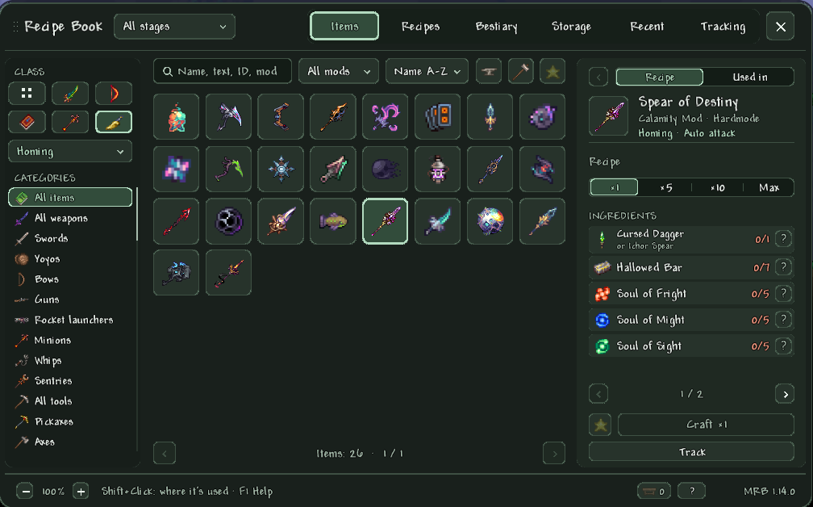
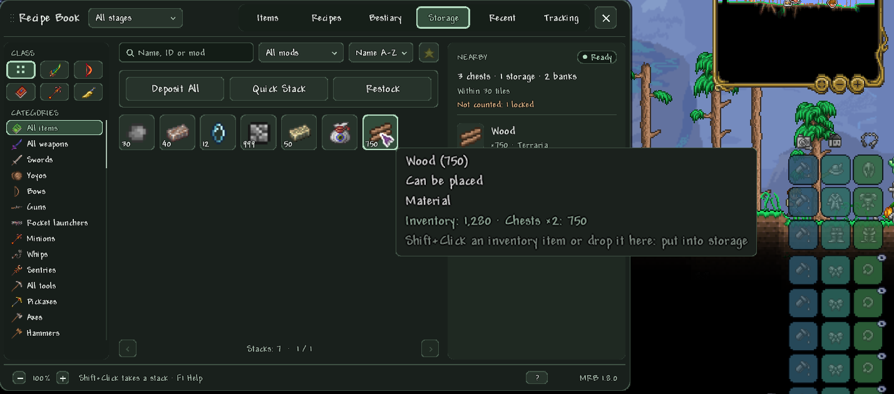

## Совместимость

Проверено на:

| | Версия | |
|---|---|---|
| Terraria | 1.4.4.9 | |
| tModLoader | 2026.08.3.0 (stable) | обязателен |
| Calamity Mod | 2.2.4 | необязателен, поддержан полностью |
| Magic Storage | 0.7.0.11, с SerousCommonLib 1.0.6.2 | необязателен, поддержан полностью |

Без Calamity и Magic Storage книга работает со всем, что есть в игре. Предметы, рецепты, добыча и мобы других модов
читаются так же, как ванильные.

## Установка

1. Скачай `ModernRecipeBook.tmod` из [последнего релиза](../../releases/latest).
2. Положи его в `Documents/My Games/Terraria/tModLoader/Mods`.
3. Включи **Modern Recipe Book** в Workshop → Manage Mods и перезагрузи моды.

На сервере поставь тот же файл и на сервер, и каждому игроку.

## Управление

Книга открывается на **Mouse3** (переназначается в «Управлении»). При открытом инвентаре Mouse3 по предмету в любом
слоте открывает этот предмет.

<b>Все сочетания</b>

| Навигация | |
|---|---|
| Ctrl+1…6 | Вкладка по номеру |
| Ctrl+Tab | Следующая вкладка |
| Mouse4 · Alt+← | Назад |
| Mouse5 · Alt+→ | Вперёд |
| ← ↑ → ↓ | Выбор в сетке |
| PgUp · PgDn | Листать страницы |
| Home · End | Первая · последняя страница |
| Esc | Закрыть верхнее окно |
| F1 | Справка |

| Предмет в карточке | |
|---|---|
| Ctrl+Enter | Создать |
| Ctrl+Shift+Enter | Создать максимум |
| Alt+T | Отслеживать |
| Alt+F | В избранное |
| Alt+G | Где взять |
| Alt+U | Рецепт · применение (у моба: добыча · параметры) |
| ЛКМ | Открыть материал |
| Shift+ЛКМ | Где используется |
| Alt+ЛКМ | Избранное из сетки |
| Mouse3 | Предмет или моб под курсором |

| Поиск и фильтры | |
|---|---|
| Ctrl+F | Поиск |
| Ctrl+Backspace | Сбросить фильтры |
| Alt+1…5 | Этап (5: до следующего босса) |
| F5 | Обновить |

| Хранилище | |
|---|---|
| ЛКМ | Взять стопку |
| ПКМ, держать | По одной |
| Shift+ЛКМ | Стопку в инвентарь |
| Ctrl+ЛКМ | В корзину |
| Ctrl+Enter | Взять выбранное |
| Ctrl+Q · Ctrl+R | Быстрый стак · пополнить |
| Shift+ЛКМ в инвентаре | Сложить стопку |
| ЛКМ с предметом | Сложить с курсора |

| Большая карта | |
|---|---|
| Mouse3 | Телепорт туда |
| ПКМ | Поставить метку |
| ПКМ по метке | Изменить или удалить |

## Настройки

«Настройки модов» → **«Книга рецептов»** (твои) и **«Книга рецептов: сервер»** (хоста).

| Настройка | По умолчанию | |
|---|---|---|
| Размер окна, % | 90% | Уменьшает книгу под маленький экран |
| Размер текста, % | 100% | Только текст, не окно |
| Поиск предмета средней кнопкой | вкл. | Mouse3 по предмету в любом слоте открывает его в книге |
| Непрозрачность / размер панели отслеживания, % | 90% / 100% | Панель оверлея отслеживания |
| Отслеживание: компактные строки | выкл. | Строки материалов под мини-картой вместо карточек |
| Рывок двойным нажатием (Calamity) | выкл. | Двойное нажатие влево или вправо — рывок |
| **Сервер:** хранилища рядом | вкл. | Показывать, считать и крафтить из сундуков и Magic Storage в радиусе |
| **Сервер:** радиус хранилищ (блоков) | 30 | 10–50 блоков |
| **Сервер:** телепорт по карте | вкл. | Mouse3 по большой карте |
| **Сервер:** общие метки на карте | вкл. | Метки, которые видят все на сервере, хранятся с миром |

## Мультиплеер

Мод двусторонний (Both) и рассчитан на серверы, в том числе Host & Play; заходящие игроки скачивают его сами.

- Взять из хранилища и положить в него выполняет сервер, проверяя каждый запрос; зажатая правая кнопка отправляется
  пачками и не упирается в ограничение сервера.
- Метки на карте общие и хранятся с миром; менять их могут только автор или хост.
- Правила появления и источники мира читаются у клиента так же, как в одиночной игре.
- Хост сам решает в **«Книге рецептов: сервер»**, включены ли хранилище рядом, телепорт и метки.

## Сборка из исходников

1. Склонируй репозиторий в `Documents/My Games/Terraria/tModLoader/ModSources/ModernRecipeBook`. Папка должна
   называться `ModernRecipeBook`: tModLoader берёт имя мода из неё.
2. В tModLoader открой Workshop → Develop Mods и нажми **Build** у Modern Recipe Book или выполни `dotnet build` в
   папке.

Каждый пуш в `main` собирает GitHub Actions ([build.yml](.github/workflows/build.yml)): `.tmod` сохраняется как
артефакт сборки, а для версии из `build.txt`, у которой ещё нет релиза, создаётся релиз с разделом этой версии из
CHANGELOG и приложенным `.tmod`.

## Устройство репозитория

| Путь | |
|---|---|
| `ModernRecipeBook.csproj` | Проект; tModLoader собирает мод из этой папки |
| `build.txt`, `description.txt`, `icon.png` | Данные мода, как их читает tModLoader |
| `src/` | Исходники на C# |
| `Localization/` | Тексты на английском и русском |
| `Assets/` | Текстуры |
| `docs/` | Заметки по устройству крупных функций и скриншоты для README (в `.tmod` не попадают) |
| `.github/workflows/` | Сборка и выпуск релизов |

## Участие в разработке

Ошибки и идеи — в [Issues](../../issues). Для ошибки напиши, что делал, что ожидал и что получилось, версии tModLoader,
Calamity и Magic Storage и приложи `tModLoader-Logs/client.log`. Pull request'ы приветствуются; тексты для игрока
пишутся на английском и русском, у каждого релиза есть запись в CHANGELOG.

## История изменений

Все версии в [CHANGELOG.md](CHANGELOG.md), новые сверху, на английском. Номера версий следуют
[семантическому версионированию](https://semver.org/lang/ru/).

## Авторы

- Автор: [h8suga](https://github.com/h8suga).
- Сделано на [tModLoader](https://github.com/tModLoader/tModLoader).
- Интеграция с [Calamity Mod](https://calamitymod.wiki.gg/) и
  [Magic Storage](https://github.com/absoluteAquarian/MagicStorage); оба мода принадлежат своим авторам.
